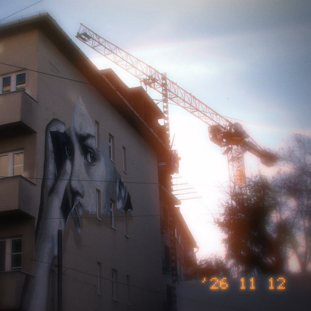
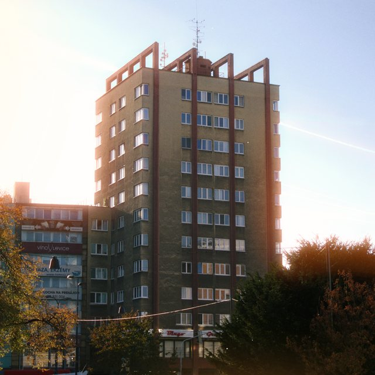
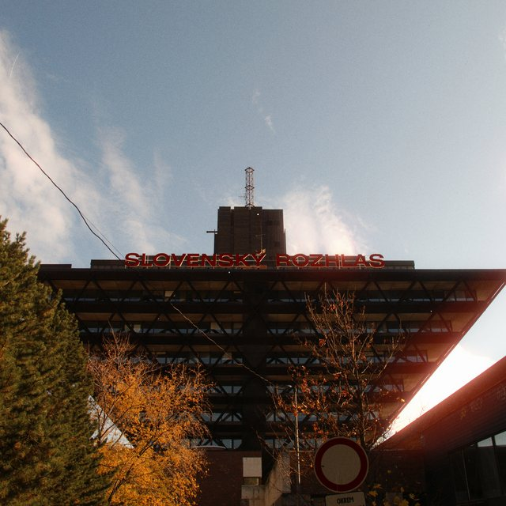
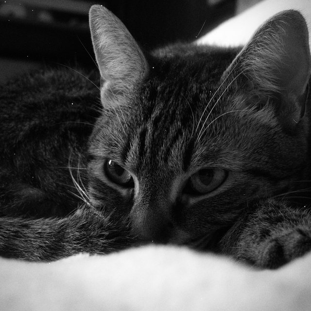
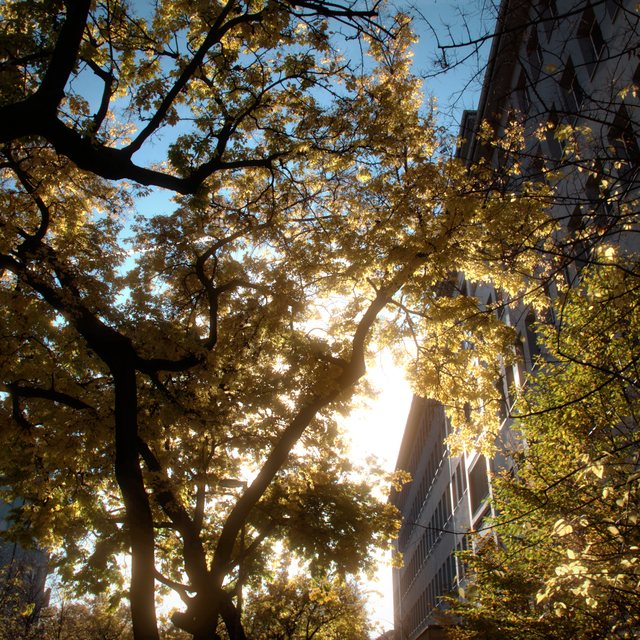
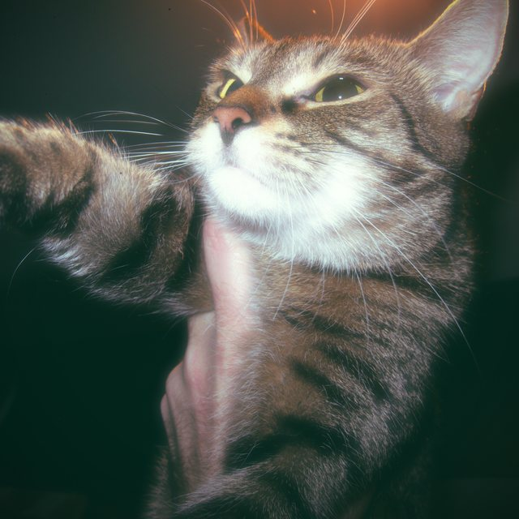
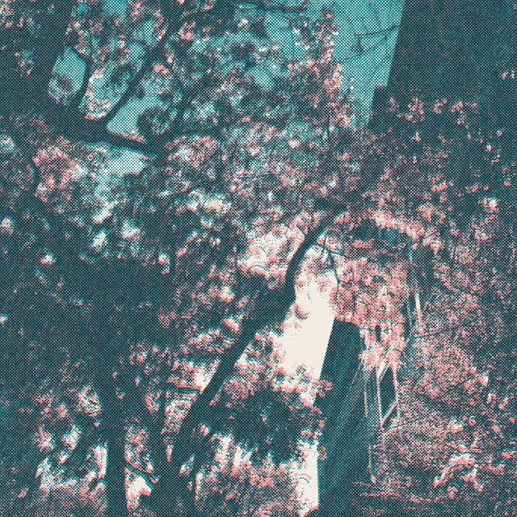
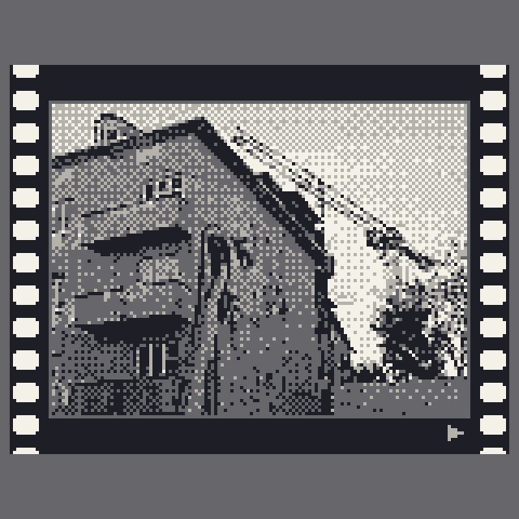
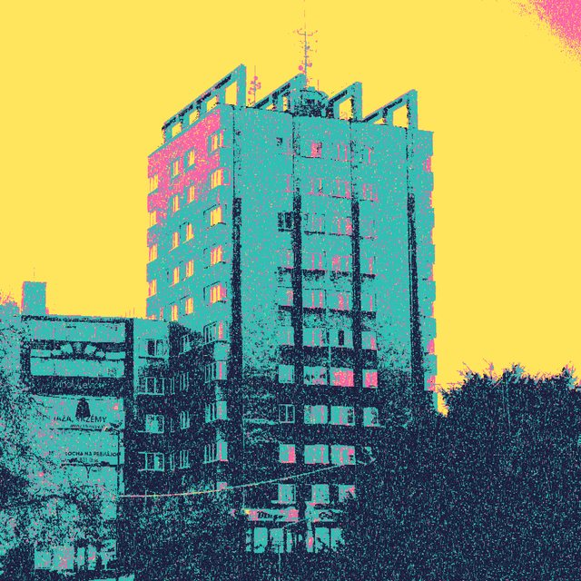
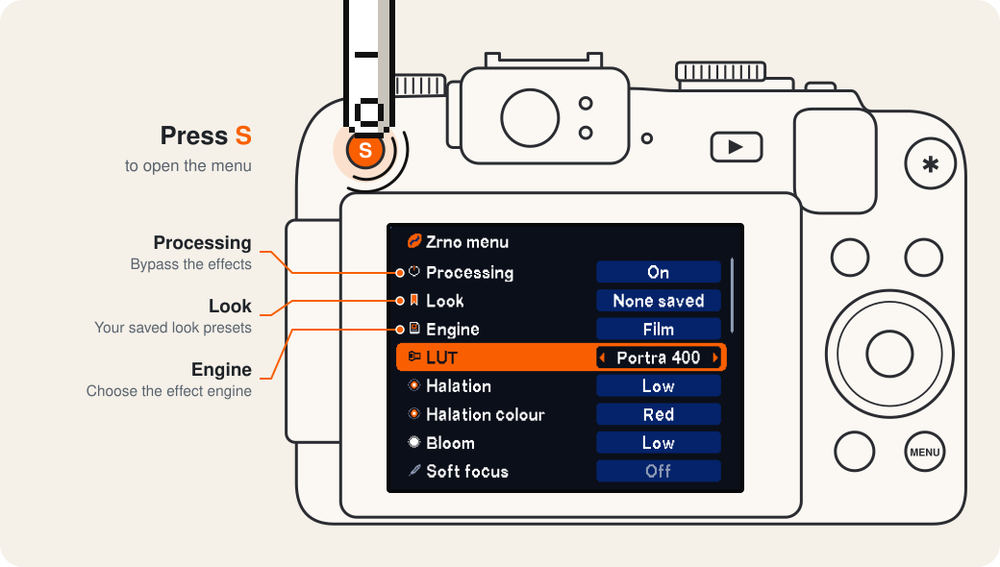

# Zrno (for Canon PowerShot G12)

Film simulation (with halation, bloom, soft focus and more), colour grading
and other effects for Canon PowerShot cameras. Hardware accelerated on the
camera's DIGIC image processor, with a live preview. Many effects are heavily
optimized for maximum performance, using the DSP instructions of the ARMv5TE
instruction set. Built on [CHDK](https://chdk.fandom.com/).

**[Open the web editor](https://suzvuk.github.io/zrno/)** to edit your shots in the browser, straight from the camera over USB.

<table>
  <tr>
    <td align="center"> Kodachrome 64 + all film effects</td>
    <td align="center"> Fuji 400H + halation, bloom, light leak, grain, dust</td>
    <td align="center"> Superia 200 + halation, bloom, grain, dust</td>
  </tr>
  <tr>
    <td align="center"> Ilford HP5 + bloom, grain, vignette, dust</td>
    <td align="center"> Velvia 50 + bloom, amber halation, vignette</td>
    <td align="center"> Polaroid 669 + bloom, soft focus, light leak, dust</td>
  </tr>
  <tr>
    <td align="center"> Print: Riso, teal + orange dots</td>
    <td align="center"> ZrnoBoy, Printer palette, Film strip frame</td>
    <td align="center"> Print: Screenprint, Pop</td>
  </tr>
</table>

The first supported camera is the **Canon PowerShot G12** with firmware
1.00G.

Your photos come out as normal `IMG_nnnn.JPG` files in the DCIM folder, with
thumbnails, ready to share. (*Zrno* is the Slovak word for grain, as in film
grain.)

> [!WARNING]
> This is unofficial firmware. It is not made, supported or endorsed by
> Canon. It changes how the camera develops and saves photos. It can crash
> the camera, lose photos or, in the worst case, damage the camera. During
> development, one experiment caused a lens error. Use it at your own risk.
> There is no warranty (see [COPYING](COPYING)). Only use it on a camera and
> firmware listed under [Supported cameras](#supported-cameras).

## Supported cameras

| Camera | Firmware | Processor | Status |
| --- | --- | --- | --- |
| Canon PowerShot G12 | 1.00G | DIGIC 4 | Supported |

Each camera model needs its own port, because the firmware addresses it
hooks into are different for every model and firmware version. A camera is
only listed after it has been tested. More DIGIC cameras may be added later.

## What it does

The first three rows are the same in every engine:

- **Processing** turns the effects on or off. When it is off, the camera
  takes normal stock photos. It is off by default.
- **Look** holds your saved presets. A preset stores an engine together with
  all of its settings, so you can switch to a favourite style in one step.
- **Engine** chooses how photos are processed: Film, ZrnoBoy, Print or
  Grade. The rows below it belong to the selected engine.

### Using the menu

Press up and down to move between rows, and left and right to change a
value. To preview a setting, press SET on its row. The menu hides, and the
live view shows the setting with a small card. Turn the control dial on the
back, or press left and right, to try other values. Press SET or MENU to go
back to the menu. The preview works for the film looks, your saved looks and
every ZrnoBoy, Print and Grade setting. Film effects are added after the
shot, so they do not show in the preview.

A half-press of the shutter button, or pressing S again, closes the menu so
you can shoot right away. Press MENU to open CHDK's own menu.

### Film

Film adds the colours of a film stock to the photo, with optional effects on
top. The live view shows the colours while you shoot. The effects are added
after the shot. Most effects can be set to Off, Low, Mid or High.

| Setting | What it does |
| --- | --- |
| LUT | Selects the film look. There are 16, for example Portra 400, Velvia 50 and Tri-X 400. |
| Halation | Adds a red or amber glow around bright lights, as seen on some cinema film. |
| Bloom | Adds a soft glow around bright areas. |
| Soft focus | Spreads the light softly into the shadows, like a diffusion filter. |
| Sharpening | Makes edges softer or crisper. |
| Grain | Adds film grain. It is different on every shot. |
| Vignette | Darkens the corners. |
| Light leaks | Adds warm light coming in from the edge of the frame. |
| Toy lens | Keeps the centre sharp and blurs the edges, like a plastic lens. |
| Dust & scratches | Adds specks, hairs and fine scratches, like an old print. |
| Date stamp | Prints the date or your own text in a corner, in orange digits. |

### ZrnoBoy

ZrnoBoy turns the photo into a 4-colour pixel picture inside a frame, in the
style of the pocket console cameras of the late 90s. The live view shows the
result while you shoot.

| Setting | What it does |
| --- | --- |
| Palette | Selects the 4 colours of the picture. |
| Frame | Selects the border around the picture, or none. |
| Resolution | Selects the picture size, 128 × 96 or 256 × 192 pixels. |
| Contrast | Makes the picture softer or harsher. |
| Brightness | Makes the picture lighter or darker. |
| Edges | Sets how strongly outlines are drawn. |
| Dither | Mixes the 4 colours in dot patterns to show more shades. When it is off, the shades are flat. |

### Print

Print makes the photo look like a risograph print, made with 2 or 3 bright
inks on paper. The inks sit slightly out of line, and the print has small
flaws like a real one. The live view shows a preview of the print.

| Setting | What it does |
| --- | --- |
| Style | Selects the printing method: Riso, Screenprint, Engraving, Woodcut, Photocopy, Comic or Text mode. |
| Inks | Selects the ink colours, for example pink and blue. |
| Separation | Prints in full colour, or in two tones from dark to light. |
| Screen | Builds the tones from random grain or from halftone dots. |
| Noise | Sets how much grain is in the ink. |
| Register | Sets how far the inks are shifted from each other. |
| Print flaws | Adds streaks, specks and missing dots. |
| Paper | Selects the paper colour. |

### Grade

Grade lets you adjust the colours of the photo yourself. The live view shows
the changes, and photos save as fast as normal. Most settings go from −5 to
+5.

| Setting | What it does |
| --- | --- |
| Grade | Selects one of 4 stored grades to use and edit. |
| Contrast | Increases or decreases the contrast. |
| Midtones, Shadows, Highlights | Makes that part of the photo lighter or darker. |
| Blacks, Whites | Moves the darkest and the brightest point of the photo. |
| Fade | Lifts the blacks for a faded, matte look. |
| Temperature | Makes the colours cooler or warmer. |
| Tint | Shifts the colours towards green or magenta. |
| Saturation | Makes the colours stronger or weaker. At −5 the photo is black and white. |
| Vibrance | Makes muted colours stronger and leaves strong colours mostly as they are. |
| Black & white | Makes the photo black and white, optionally through a colour filter as used with film. |
| HSL | Changes the hue, saturation or lightness of one colour only, for example only the blues. |
| Shadow tone, Highlight tone | Adds a colour to the shadows or to the highlights. |
| Sharpening | Makes edges softer or crisper. |
| Reset grade | Returns the selected grade to neutral. |

### Settings

The **Settings** rows at the bottom of the menu belong to the camera, not to
a look.

| Setting | What it does |
| --- | --- |
| Indicator | Shows a small card on the shooting screen, at the bottom or the top, or hides it. The card shows the look's name and an icon for each active effect. |
| Busy LEDs | Blinks the camera's lights while a photo is being processed. |
| S button opens | Chooses whether S opens the Zrno menu or CHDK's ALT mode. |
| Live preview | When off, the screen shows the normal stock live view while ZrnoBoy or Print is the engine. |
| CHDK menu | Opens CHDK's main menu. |

### Re-develop a photo

You can apply a different look to a photo you have already taken. Open the
photo in playback mode, press S and choose **Re-develop photo**. Zrno
develops the photo again with the settings that are selected now and saves
it as a new file. The original photo is kept. This works for photos taken
with Processing on. The feature is still experimental.

More details are in [docs/FEATURES.md](docs/FEATURES.md).

## Documentation

- [Features](docs/FEATURES.md) describes the menu, the looks and effects,
  and the files on the memory card. The other engines have their own pages:
  [Grade](docs/GRADE.md), [ZrnoBoy](docs/ZRNOBOY.md) and
  [Print](docs/PRINT.md).
- [Building](docs/BUILDING.md) explains how to build Zrno from source, run
  the tests and make a release.
- [Architecture](docs/ARCHITECTURE.md) explains how Zrno connects to the
  camera's image processing, which G12 details it relies on, and how to port
  it to another camera.
- [USB tools](docs/USB.md) covers logs, screenshots and test boots over USB.
- [web/](web/README.md) is a browser version of the camera's effects. It
  works on the sensor backups from a memory card.

## Getting it onto a camera

Download `zrno-VERSION-g12-100g.zip` from
[Releases](https://github.com/suzvuk/zrno/releases) and unzip it. Then:

1. Check that your camera has firmware 1.00G. `INSTALL.TXT` in the zip shows
   how.
2. Set up the SD card so that the G12 can start CHDK, and copy Zrno onto it.
   The included installer, `install.command`, does both for you. It erases a
   card that is not set up yet, and keeps your photos when it updates a card
   that is.
3. Lock the card, put it in the camera and switch the camera on. Press S to
   open the Zrno menu.

Releases also have zips for firmware 1.00C, 1.00E and 1.00F, with
"untested" in their names. They are built from CHDK's own port for each
firmware, but they have not been tested on a camera.

The installer has only been tested on a Mac so far. On other systems, set
the card up by hand as described in `INSTALL.TXT`.

Nothing is installed in the camera itself. When the card is unlocked, the
camera starts as a normal stock camera.

To build Zrno yourself, see [docs/BUILDING.md](docs/BUILDING.md).

## Inspiration, development and use of AI

Zrno started as a CHDK experiment that applied HaldCLUT film looks to saved
photos. Each photo took over a minute, so I dug into the firmware (without
copying any of its code) and found that the DIGIC has a hardware colour
table, the one behind the My Colors modes. The first proof was a test photo
that came out in Teal & Orange with Zrno switched off, because the camera
itself was doing the work. The film looks now run on that table, show live
on the screen, and a photo saves in about 3 seconds.

The effects run on the camera's 144 MHz processor, which turned out to be
running at its top speed already. So every effect had to get faster through
better code, and each speed-up was checked in an emulator to give exactly
the same pixels before it went onto the camera. Not every experiment went
well: one test with the camera's DMA hardware ended in a lens error, and
that route was dropped.

I used AI agents as assistants for research and code. I decided what to
build, reviewed the work and tested it on the camera. Without them, I would
not have had the time or the motivation to finish.

Contributions are welcome. I would love to hear if Zrno can be ported to
other cameras, maybe even beyond the DIGIC 4.

## Licence

Copyright (C) 2026 suzvuk. Zrno is free software under the
[GNU GPL, version 2 or later](COPYING). It builds on CHDK (GPL). The fifteen
RawTherapee-derived looks are CC BY-SA 4.0. Film and product names identify
the stocks the looks approximate. Zrno is not affiliated with or endorsed
by their owners. See [THIRD_PARTY.md](THIRD_PARTY.md).
